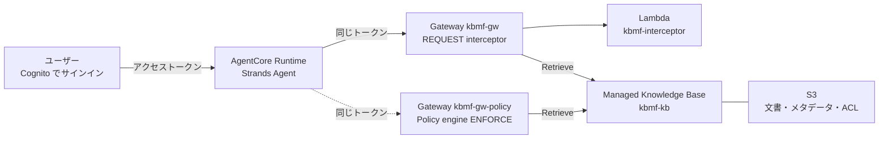

# agentcore-kb-metadata-filter

Amazon Bedrock の Managed Knowledge Base に対するメタデータフィルタと ACL（userContext）を、AgentCore Gateway 経由でどう制御するかを確かめるための検証一式です。

LLM にツールとして Retrieve を渡すと、LLM が filter や userContext を自分で書けてしまいます。このリポジトリでは、それを次の 2 つの方法で止める構成を作り、実際に呼び出して挙動を記録します。

| 方法 | 何をするか | 置き場所 |
|---|---|---|
| REQUEST interceptor（Lambda） | LLM が書いた userContext と filter を、Cognito のトークンのクレームで入れ直す | `lambdas/interceptor.py`、`scripts/03_gateway.py` |
| AgentCore Policy（Cedar） | userContext.userId がトークンの email と一致しない呼び出しを拒否する | `scripts/04_policy.py` |

## 構成



- ユーザーのアクセストークンは、Runtime からエージェント、エージェントから Gateway へそのまま渡します（トークン交換はしません）。Runtime と Gateway はどちらも `customJWTAuthorizer.allowedClients` で Cognito の同じクライアントを受け付けます
- Cognito の Pre Token Generation（V3）で、アクセストークンに `email` と `department` を入れます（`lambdas/pretoken.py`）
- Gateway のターゲットは `bedrock-knowledge-bases` コネクタの Retrieve です。LLM に見せる引数の違いで 3 つ用意します

| ターゲット | LLM に見える filter | interceptor の扱い |
|---|---|---|
| `locked` | 見えるが、説明は「無視される」 | LLM の filter を捨てて `department` の条件に置き換える |
| `open` | 書ける | LLM の filter と `department` の条件を `andAll` で重ねる |
| `static` | 見えない（`year = 2026` を固定） | filter は触らない |

どのターゲットでも、`userContext.userId` はトークンの `email` で上書きします。

## 用意するデータ

| 文書 | department | year | ACL（読めるユーザー） | メタデータの書式 |
|---|---|---|---|---|
| `hr/salary-bands` | hr | 2026 | user-a | 型付き |
| `hr/hiring-plan` | hr | 2026 | user-a, user-b | 平ら |
| `sales/q3-pipeline` | sales | 2026 | user-a, user-b | 型付き |
| `sales/discount-rules` | sales | 2026 | user-b | 型付き |

ユーザーは 2 人です。`user-a@example.com` が人事部（hr）、`user-b@example.com` が営業部（sales）です。

## 前提

- 東京リージョン（`ap-northeast-1`）で動かします。`AWS_REGION` で変えられますが、Managed Knowledge Base と AgentCore Policy が使えるリージョンに限ります
- Bedrock で Claude Sonnet 4.6 を `jp.` の推論プロファイル（`jp.anthropic.claude-sonnet-4-6`）から呼べること
- AWS の認証情報（IAM ロール、Cognito、Lambda、S3、Bedrock、AgentCore を作れる権限）
- Python 3.12 以上と [uv](https://docs.astral.sh/uv/)（Runtime に載せる arm64 の依存を集めるのに使います）

```bash
uv venv && source .venv/bin/activate
uv pip install -r requirements.txt
export AWS_PROFILE=<使うプロファイル>
```

## 手順

`scripts/` に移って、番号順に実行します。作ったリソースの ID とユーザーのパスワードは `.state.json` に保存されます（`.gitignore` 済み）。トークンは画面にもファイルにも出しません。

```bash
cd scripts

# 作る
python 01_cognito.py        # ユーザープール、web クライアント、ユーザー 2 人、Pre Token Generation
python 02_knowledge_base.py # S3 に文書とメタデータ、Managed Knowledge Base、取り込み
python 03_gateway.py        # interceptor の Lambda、Gateway kbmf-gw、ターゲット 3 つ
python 04_policy.py         # Policy engine、ポリシー 2 本、Gateway kbmf-gw-policy
python 05_runtime.py        # エージェントを zip にして AgentCore Runtime に置く

# 確かめる（結果は results/ に JSON で残ります）
python 10_test_kb_direct.py # Gateway を通さず、KB を直接 Retrieve
python 11_test_gateway.py   # Gateway 経由。ツール引数は自分で書いて送る
python 12_test_llm.py       # Runtime 上の LLM に Gateway のツールを渡して頼む
python 13_test_policy.py    # Cedar で userContext の偽装が止まるか

# 消す
python 99_cleanup.py
```

各スクリプトは何度実行しても同じ名前のリソースを使い回します。途中で失敗したら、原因を直してそのスクリプトから実行し直してください。

## 確かめること

| スクリプト | 記号 | 内容 |
|---|---|---|
| `10_test_kb_direct.py` | M1 | userContext なし / user-a / user-b で、出てくる文書が ACL どおりに変わるか |
| | M2 | 平らな書式と型付きの書式のどちらでも filter が効くか |
| | M3 | filter と ACL が重なって効くか。未対応の演算子（`startsWith`）でどうなるか |
| `11_test_gateway.py` | G0 | 3 つのターゲットで、LLM に見える inputSchema |
| | G1 | `locked` で、何も書かなくてもトークンの department で絞られるか |
| | G2 | `locked` に department=hr の filter や他人の userContext を書いて送ったらどうなるか |
| | G3 | `open` で、user-b が書いた filter と department の条件が重なるか |
| | G4 | `static` に department=hr を書いて送ったらどうなるか |
| | G5 | `static` の固定値を 2025 に変えて 0 件になるか（終わったら 2026 に戻します） |
| | G6 | interceptor のログで、受け取った引数と送った引数を見比べる |
| `12_test_llm.py` | L1 | `open` を渡された LLM が filter をどう書くか |
| | L2 | 同じ頼みを `locked` で。LLM が何を書いても department=sales に置き換わるか |
| `13_test_policy.py` | P1 | user-b のトークンで userContext に user-a を書く |
| | P2 | userContext を書かない |
| | P3 | userContext に自分（user-b）を書く |

LLM の出力は毎回変わります。L1 で LLM が filter を書くかどうか、何を書くかは実行ごとに違ってかまいません。interceptor のログに残る `received` と `sent` を見れば、LLM が書いた値と Gateway が KB に送った値の違いが分かります。

文書は英語で書いてあります。LLM が日本語で検索語を書くと（例：「2026年 営業パイプライン」）、読める文書があっても 0 件になることがあります。filter とは関係なく、検索の関連度で落ちています。filter の効き目は 0 件かどうかではなく、interceptor のログの `sent` で確かめてください。

## 実装で気をつけたこと

- interceptor が書き換える引数は `visible: true` のままにしています。`visible: false` にした引数は、interceptor が書いても `cannot set parameter(s)` で弾かれます。そのため、見えている引数を毎回必ず上書きする作りにしています
- `department` クレームが無いトークンでは、filter をどの文書にも一致しない値（`__no_department__`）にします。`email` が無いときの userContext も同様です
- Policy engine を付けた Gateway の実行ロールには `bedrock-agentcore:GetPolicyEngine`、`AuthorizeAction`、`PartiallyAuthorizeActions` が必要です
- ポリシーは `validationMode="IGNORE_ALL_FINDINGS"` で作ります。既定の検証だと、スキーマに無い `context.input` を参照する式で permit まで弾かれます
- Policy engine、ポリシー、Runtime の名前にはハイフンを使えないので `_` にしています

## 費用と後片付け

課金されるのは主に、Managed Knowledge Base（取り込みと検索）、Gateway の呼び出し、Runtime の実行時間、Claude Sonnet 4.6 の呼び出し、Lambda、S3、CloudWatch Logs です。テストで送るリクエストは数十回程度ですが、Knowledge Base などは置いておくだけで費用がかかるものもあるので、確かめ終わったらすぐに `99_cleanup.py` を実行してください。料金は各サービスの料金ページで確認してください。

`99_cleanup.py` は `.state.json` が無くても動くように、名前の頭（`kbmf`）でリソースを探して消します。

| 種類 | 名前 |
|---|---|
| AgentCore Runtime | `kbmf_agent` |
| AgentCore Gateway | `kbmf-gw`、`kbmf-gw-policy`（ターゲットごと） |
| Policy engine | `kbmf_pe`（ポリシーごと） |
| Knowledge Base | `kbmf-kb`（データソースごと） |
| S3 バケット | `kbmf-docs-<アカウント ID>`、`kbmf-code-<アカウント ID>` |
| Lambda | `kbmf-pretoken`、`kbmf-interceptor` |
| Cognito ユーザープール | `kbmf-pool` |
| IAM ロール | `kbmf-kb-role`、`kbmf-gateway-role`、`kbmf-runtime-role`、`kbmf-lambda-role` |
| CloudWatch Logs | `/aws/lambda/kbmf-*`、`/aws/bedrock-agentcore/runtimes/kbmf_*` |

Runtime、Gateway、Policy engine、Knowledge Base の削除に失敗したときは、そこで止まります。Gateway と Knowledge Base は削除のときにも実行ロールを使うので、先にロールを消すと削除できなくなるためです。失敗が表示されたら、少し待ってからもう一度実行してください。

## 記事との違い

このリポジトリは、Qiita の記事を書くために行った検証を、第三者が動かせる形に整理し直したものです。整理の都合で、記事の元になった検証とは次の点が違います。

- 元の検証では、Runtime で受けたトークンを Gateway 用のトークンに交換（On-Behalf-Of）し、`allowedAudience` で検証していました。ここでは同じ Cognito クライアントのトークンをそのまま渡し、`allowedClients` で検証します。interceptor が読むクレーム（`email`、`department`）は同じです
- 記事にある「interceptor と Policy を組み合わせた構成」は含めていません。Policy は interceptor を付けない Gateway だけで確かめます
- ACL を持たない文書は入れていません

## ライセンス

MIT
